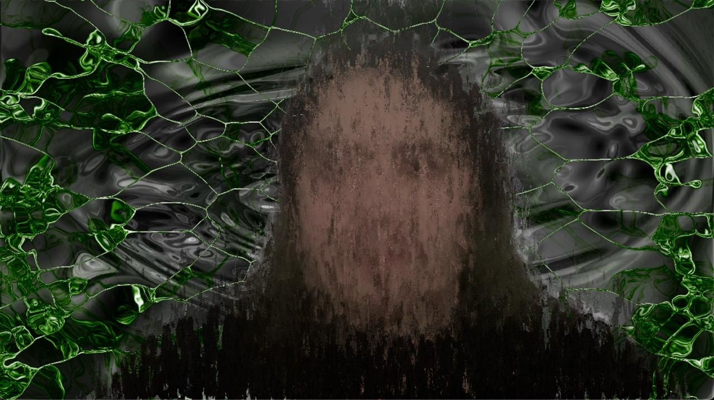
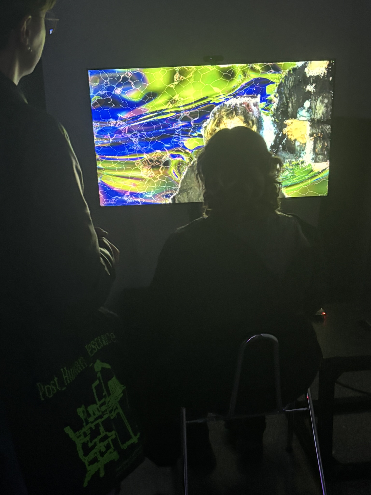
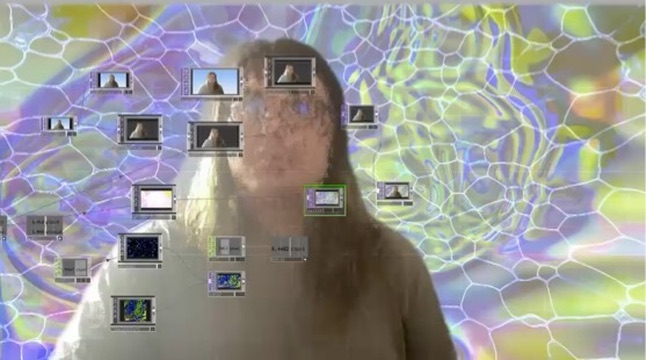
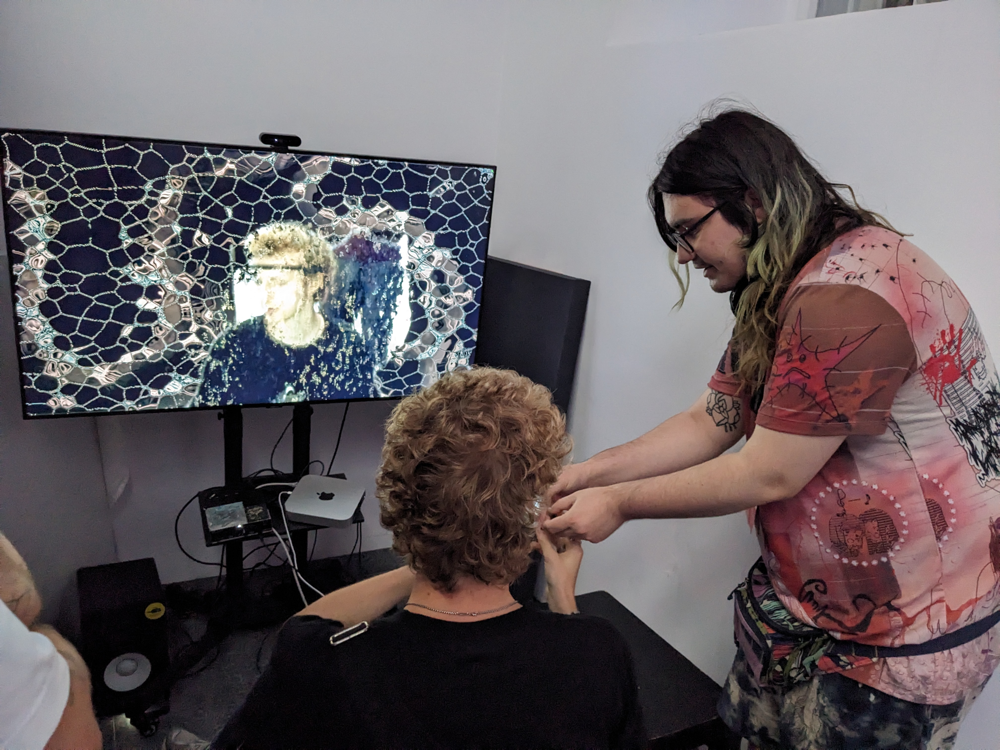

{::nomarkdown}

<article class="resonance-page">
  
<strong>Resonance</strong>Interactive audiovisual installation · Ars Electronica 2025

  <header class="r-hero">
    

Case study2024—2025
<h1>A mirror to your unconscious.</h1>

Resonance turns involuntary signals from the face, brain, and skin into a live audiovisual portrait. You do not tell it how you feel. It listens to what escapes.

Muse 2 EEG · GSR · facial expression recognition · Max MSP · TouchDesigner

    
<video controls loop playsinline preload="metadata" poster="/assets/img/resonance/mirror-poster.jpg" aria-label="A participant facing their distorted live portrait, with the installation's original sound"><source src="/assets/img/resonance/mirror-portrait.mp4" type="video/mp4"></video>
Live installation excerpt · sound on00:21

  </header>
  <section class="r-thesis">
00 / Premise
<blockquote>Most mirrors return appearance. <em>This one returns a changing model of your emotional state.</em></blockquote></section>
  <section class="r-chapter">
01 / Sensing

<header class="r-chapter-head"><h2>Three witnesses, none complete.</h2>
Resonance combines three imperfect views of the participant. Each signal contributes a different kind of evidence; together they form a provisional emotional reading rather than a clinical diagnosis.
</header>
    

      

<strong>EEG</strong><small>Electrical activity Muse 2 headset</small>
<svg class="r-trace" viewBox="0 0 600 92" role="img" aria-label="Illustrative EEG trace"><path class="grid" d="M0 23H600M0 46H600M0 69H600"/><path class="wave eeg" d="M0 48L15 45L26 56L39 33L51 61L65 42L81 50L96 15L110 72L126 39L142 48L159 44L173 57L189 22L204 64L221 45L237 49L250 35L266 59L283 29L298 61L315 43L332 47L349 17L364 74L382 38L398 54L414 42L430 49L446 27L462 65L480 40L497 52L515 34L531 58L548 30L564 60L581 43L600 48"/><path class="cursor" d="M472 4V88"/></svg>
<strong>Pattern, not thought</strong>The model estimates affective tendencies from brain activity; it does not read a participant’s mind.

      

<strong>GSR</strong><small>Skin conductance Arousal estimate</small>
<svg class="r-trace" viewBox="0 0 600 92" role="img" aria-label="Illustrative GSR trace"><path class="grid" d="M0 23H600M0 46H600M0 69H600"/><path class="wave gsr" d="M0 69C54 68 72 66 98 64C127 62 146 58 168 44C190 30 204 36 225 49C245 62 270 57 292 51C316 44 339 45 359 34C382 20 401 26 422 43C445 61 475 57 498 49C524 40 546 42 566 30C582 21 590 25 600 27"/><path class="cursor" d="M472 4V88"/></svg>
<strong>Activation</strong>Skin response contributes a broad estimate of physiological arousal: calm or activated, not good or bad.

      

<strong>Face</strong><small>Six expressions Camera input</small>
<svg class="r-trace" viewBox="0 0 600 92" role="img" aria-label="Illustrative facial expression confidence trace"><path class="grid" d="M0 23H600M0 46H600M0 69H600"/><path class="wave face" d="M0 66C44 62 72 60 105 59S164 55 198 51S253 49 282 54S329 57 361 48S406 27 440 25S489 36 522 21S569 16 600 11"/><path class="cursor" d="M472 4V88"/></svg>
<strong>Visible expression</strong>The camera classifies neutral, sadness, happiness, anger, surprise, and fear with changing confidence.

    

</section>
  <section class="r-chapter">
02 / Interpreting

<header class="r-chapter-head"><h2>Emotion becomes coordinates.</h2>
The signal estimates are translated into Valence, Arousal, and Dominance. The moving point gives the system one shared language for choosing sound and image behaviours.
</header>
    

<svg viewBox="0 0 620 440" role="img" aria-labelledby="vad-title vad-desc"><title id="vad-title">Valence and arousal trajectory</title><desc id="vad-desc">An illustrative emotional trajectory moving from tense and low valence toward activated and positive.</desc><path class="r-gridline" d="M60 60H580M60 140H580M60 220H580M60 300H580M60 380H580M140 40V400M230 40V400M320 40V400M410 40V400M500 40V400"/><path class="r-axis" d="M60 380H580M60 380V40"/><text class="r-quadrant" x="72" y="58">activated / negative</text><text class="r-quadrant" x="456" y="58">activated / positive</text><text class="r-quadrant" x="72" y="365">calm / negative</text><text class="r-quadrant" x="476" y="365">calm / positive</text><text class="r-quadrant" x="507" y="417">valence →</text><text class="r-quadrant" transform="translate(22 143) rotate(-90)">arousal →</text><path class="r-journey" d="M178 286C210 259 194 218 236 198S293 235 326 197S366 128 414 142S465 120 503 88"/><circle class="r-point" cx="178" cy="286" r="6"/><circle class="r-point" cx="236" cy="198" r="6"/><circle class="r-point" cx="326" cy="197" r="6"/><circle class="r-point" cx="414" cy="142" r="6"/><circle class="r-point final" cx="503" cy="88" r="8"/></svg>Illustrative participant trajectory · not a diagnostic measure

Valence
<strong>negative ↔ positive</strong>
Influences harmony, musical mode, colour, and image treatment.

Arousal
<strong>calm ↔ activated</strong>
Influences density, rhythmic activity, motion, and visual intensity.

Dominance
<strong>submissive ↔ in control</strong>
Adds context to the emotional reading and how forcefully the system responds.

  
</section>
  <section class="r-chapter r-audio-chapter">
03 / Sound

<header class="r-chapter-head"><h2>The score changes its emotional gravity.</h2>
Resonance does not select a fixed soundtrack. It composes in real time: VAD coordinates reshape the key, mode, voicing, melodic probability, rhythmic density, synthesis, and effects.
</header>
    

<b>Ionian</b>bright · resolved

<b>Dorian</b>minor · lifted 6th

<b>Phrygian</b>minor · tense 2nd

<b>Lydian</b>major · raised 4th

<b>Mixolydian</b>major · open 7th

<b>Aeolian</b>natural minor

<b>Locrian</b>unstable · diminished

    

<h3>Modal harmony engine</h3>
The tonal music-theory library converts the emotional model into a root key and one of seven modes, then builds triad and seventh-chord voicings around that harmonic field.

Valence<strong>Low values bias minor and diminished intervals; high values favour brighter major structures.</strong>

Character<strong>Voicings prioritise each mode’s distinctive notes so a change of mode is perceptible, not cosmetic.</strong>

Tension<strong>Unstable intervals—including diatonic tritones—are removed or admitted according to emotional tension.</strong>

<h3>Melody + rhythm</h3>
A probabilistic Markov chain generates melodic movement in sync with the installation tempo. Arousal raises event density and rhythmic activity; dominance changes how forcefully the sound asserts itself.

<i></i><i></i><i></i><i></i><i></i><i></i><i></i><i></i><i></i><i></i>

Arousal<strong>Tempo-linked probability, percussion density, and modulation activity.</strong>

Dominance<strong>Patch intensity, spectral weight, and the firmness of rhythmic articulation.</strong>

    

01 · source<strong>Max MSP + Markov engine</strong><small>Notes, chords, rhythm, and biometric triggers</small>

02 · voice<strong>Vital + percussion</strong><small>Synthesis and patches modulated by arousal and dominance</small>

03 · space<strong>ChowMultiTool + Valhalla</strong><small>Processing and delay snapshots shift with the emotional state</small>

  
</section>
  <section class="r-chapter">
04 / Feedback

<header class="r-chapter-head"><h2>Then the mirror answers back.</h2>
The output is not an endpoint. The participant sees and hears the interpretation, reacts to it, and changes the next set of signals. Resonance is a loop in which observation becomes intervention.
</header>
    

<svg viewBox="0 0 560 520" role="img" aria-labelledby="loop-title loop-desc"><title id="loop-title">Resonance feedback loop</title><desc id="loop-desc">The participant is sensed, interpreted, translated to sound and image, perceives the result, and responds again.</desc><circle class="r-loop-ring" cx="280" cy="260" r="184"/><path class="r-loop-path" d="M280 76C382 76 464 158 464 260S382 444 280 444S96 362 96 260S178 76 280 76"/><circle class="r-loop-node active" cx="280" cy="76" r="48"/><text class="r-loop-label" x="280" y="72">Body</text><text class="r-loop-small" x="280" y="90">face · EEG · GSR</text><circle class="r-loop-node" cx="464" cy="260" r="48"/><text class="r-loop-label" x="464" y="256">Model</text><text class="r-loop-small" x="464" y="274">V · A · D</text><circle class="r-loop-node" cx="280" cy="444" r="48"/><text class="r-loop-label" x="280" y="440">Output</text><text class="r-loop-small" x="280" y="458">sound · image</text><circle class="r-loop-node" cx="96" cy="260" r="48"/><text class="r-loop-label" x="96" y="256">Perception</text><text class="r-loop-small" x="96" y="274">see · hear · react</text><text class="r-loop-core" x="280" y="252">The artwork</text><text class="r-loop-core" x="280" y="282">listens back.</text></svg>

<video controls loop playsinline preload="metadata" poster="/assets/img/resonance/feedback-poster.jpg" aria-label="The live portrait shifting colour and texture as a participant watches, with the installation's original sound"><source src="/assets/img/resonance/feedback-shift.mp4" type="video/mp4"></video>

  
</section>
  <section class="r-chapter">
05 / Image

<header class="r-chapter-head"><h2>The portrait refuses to settle.</h2>
The same emotional coordinates that shape the score also reshape the participant’s image. Sound changes the atmosphere; the image makes them the subject of it.
</header>
    

<h3>Emotion becomes image.</h3>
TouchDesigner combines the live camera feed, Voronoi structures, recorded material, and controlled compression artifacts. The participant remains recognisable, but never stable.

live image → spatial fragmentationVAD state → colour + motion treatmentfeedback → compression + rupture

  
</section>
  <section class="r-chapter">
06 / In the room

<header class="r-chapter-head"><h2>Built as a room, not a screen.</h2>
The screen, chair, sensor fitting, operator, and darkened enclosure turn a technical pipeline into an intimate encounter. The participant sits close enough for the image to feel less like media and more like an altered reflection.
</header>
<figure><figcaption>The encounter: participant, sensor, portrait.</figcaption></figure><figure><figcaption>The operator view: signals and confidence remain visible.</figcaption></figure><figure><figcaption>The threshold: fitting the Muse 2 EEG headset.</figcaption></figure>

</section>
  <section class="r-closing">
<h2>You change the portrait. The portrait changes you.</h2>
Resonance is not a machine for revealing a single hidden truth. It is a mirror for the unstable space between body, interpretation, and self-perception.

</section>
  <footer class="r-foot">Resonance · Andrei GheorgheArs Electronica 2025 · PANIC — yes/no?</footer>
</article>

{:/nomarkdown}

